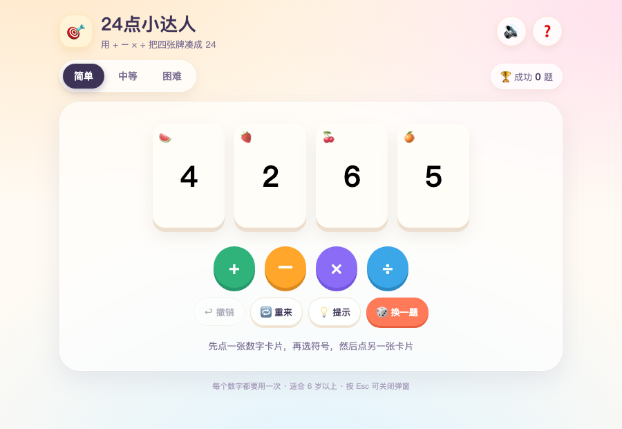

# 24点小达人 🎯

一个适合小朋友练习「24 点」的数学小游戏。纯前端、零依赖，打开网页就能玩，手机和平板也能用。



## 在线试玩

👉 **https://aiuonly.github.io/twenty-four-game/**

## 怎么玩

1. 点一张数字卡片，选中它。
2. 点一个符号：`+` `−` `×` `÷`。
3. 再点另一张卡片，两张牌就合成一张新牌。
4. 把 4 张牌合成 1 张，结果正好是 **24** 就成功啦！

每个数字都要用一次。算错了可以「撤销」，卡住了可以「提示」。

## 难度

| 难度 | 数字范围 | 说明 |
| --- | --- | --- |
| 简单 | 1–9 | 只需要 + − ×，中间结果不会是负数 |
| 中等 | 1–10 | 加减乘除都可以 |
| 困难 | 1–13 | 加减乘除都可以，数字更大 |

题目随机生成，并且保证一定有解。

## 功能

- 随机生成一定有解的 24 点题目
- 撤销 / 重来 / 换一题 / 提示
- 成功题数、连续答对记录（保存在浏览器本地）
- 音效开关、答对时的庆祝动画
- 手机 / 平板 / 电脑自适应
- 无需联网、无第三方依赖

## 本地运行

直接用浏览器打开 `index.html` 即可。也可以起一个本地服务器：

```bash
python3 -m http.server 8000
# 然后打开 http://localhost:8000
```

## 测试

求解器和出题逻辑有单元测试（需要 Node.js 18+）：

```bash
node --test test/solver.test.js
# 或者
npm test
```

## 部署到 GitHub Pages

1. 打开仓库的 **Settings → Pages**。
2. Source 选择 **Deploy from a branch**，分支选 `main`，目录选 `/ (root)`。
3. 保存后访问 `https://<你的用户名>.github.io/<仓库名>/`。

## 文件结构

```
twenty-four-game/
├── index.html          # 页面结构
├── styles.css          # 样式
├── game.js             # 界面与游戏交互
├── solver.js           # 24 点求解器与出题逻辑（纯函数）
├── test/
│   └── solver.test.js  # 求解器单元测试
├── package.json
└── README.md
```
